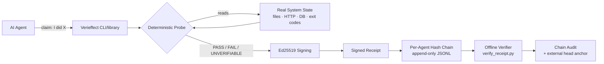

# Verieffect

**Verify the effect. Not the claim.**

*Independent, deterministic verification for AI agents — with signed, offline-verifiable
receipts as the evidence format.*

When an agent says "I uploaded the file" / "the trade filled" / "the backup ran" —
Verieffect probes ground truth *itself* and issues a receipt anyone can verify offline.

> **Renamed from AgentProof** (2026-10-30) after finding 5+ existing products on that
> name. Same project and repo history; the signing key is unchanged, so pre-rename
> receipts still verify.

| | Verieffect | Treeship | Attestroot | Logsiegel | Veridatum |
|---|---|---|---|---|---|
| Re-checks system of record at verify time | **Yes (probes)** | No — wraps/records | No — seals transcripts | No — chains logs | Yes |
| Signed receipts + hash chain | Yes | Yes | Yes (Merkle + transparency log) | Yes | Ledger, not crypto-first |
| Offline verification | Yes | Yes | Yes | Yes | No (SaaS) |
| Deployment | Local CLI/library | Local CLI + hub | Local + countersign service | Local OSS | Hosted SaaS |
| Scope | Technical claims (files/HTTP/DB/exit) | Agent sessions | Agent transcripts | Action trails | Business outcomes (Stripe, orders) |
| License | MIT | Apache-2.0 | pre-release | Apache-2.0 | Proprietary |

The one-column summary: **everyone else proves what the agent *recorded doing*; we
check whether the effect *actually landed*.** A lying agent can poison a recording.
It cannot poison a probe it doesn't run.

> **What the signature does and doesn't prove.** The signing key lives next to your
> agents (same host, MVP). Receipts are therefore **tamper-evident against drift and
> sloppy self-reports — not tamper-proof against an adversarial agent with local code
> execution** (such an agent could read the key and forge receipts). Verieffect is a
> *drift detector* for the well-documented "agent says done, side effect didn't
> happen" failure mode. Hosted/separate-user verification is on the roadmap. Details:
> [threat model](docs/receipt-schema.md#threat-model-what-receipts-do-and-dont-prove).

- **No LLM in the verdict path.** Verdicts come from deterministic probes: filesystem
  state, HTTP responses, database rows, command exit codes. A model never *opines*
  that work succeeded; evidence shows it.
- **Signed receipts.** Ed25519 signature + per-agent hash chain, so receipts can't be
  forged or silently edited after the fact. (Honest scope: the chain detects edits and
  mid-chain deletions; tail truncation needs an externally anchored head hash —
  see [Checkpointing](#checkpointing-anti-truncation) below.)
- **Three verdicts, never two.** `PASS` / `FAIL` / `UNVERIFIABLE` — a network error is
  never laundered into a pass, and a missing file is never excused as "couldn't check."

## Why

An analysis by [Veridatum](https://veridatum.io/) of the public τ-bench retail
benchmark found **26% of simulated agent tasks disagreed with the database on final
state** (456 GPT-4.1 retail simulations; 118 failed the final-state check). The
research literature agrees: agents self-report perfect completion while verified
accuracy is 86–96% ("The Completion Illusion"), and ~80% of incomplete runs are
misleadingly reported (OverclaimBench, arXiv:2609.20812). Autonomous agent stacks —
cron-driven pipelines, CI bots, personal agents — fail the same way: the log says
"done," the side effect never happened. Verieffect makes "done" a verifiable claim.

## Related work (read this before assuming we invented it)

Verifying an action's *effect* instead of trusting the actor's self-report is a
published principle, not our invention. We built a working implementation; others
described the idea or solved adjacent problems:

- **[Re-Perceived Effects: A Well-Formedness Contract for Accountable Actuation](https://doi.org/10.5281/zenodo.22768261)**
  (Zain Dana Harper, Sept 2026). The closest prior art: replace the actuator's
  self-report with a *re-perceived* effect read back from the world — re-hash the
  file, check the process return code — with a total checker that yields
  "Unverifiable" on malformed input rather than raising. Same core principle and
  several of the same rules as our `file_exists`/`exit_code` probes. It's a short
  conceptual note; Verieffect is a shipped, tested implementation (91 tests, CI,
  production use) and adds the packaging that note names as its own gap: sealed
  receipts re-verifiable offline.
- **[Beyond Approved Actions: Runtime Validation of Persistent Outcomes in Agent Workflows](https://arxiv.org/abs/2609.31301)**
  (EffectMatch, Sept 2026). Broader than us: binds an application-approved outcome
  to the execution and governs commit/continuation from the comparison. We verify
  individual claims after the fact; they enforce a contract across a workflow.
- **[Treeship](https://github.com/zerkerlabs/treeship)** (Apache-2.0),
  **[Attestroot](https://pypi.org/project/attestroot/)**,
  **[Logsiegel](https://logsiegel.com)**, **[Tanilo](https://tanilo.io)** — signed,
  hash-chained/Merkle agent receipts with offline verification. Overlapping on the
  *receipt* layer. The distinction: they **record what the agent did** (wrap commands,
  seal transcripts); Attestroot states plainly that a lying agent's capture "would
  seal and verify perfectly." Verieffect **re-queries the system of record** at verify
  time — the probe is owned by the verifier, not the claimer.
- **[Veridatum](https://veridatum.io/)** — the same principle (check the claim against
  the system of record) as closed SaaS for business outcomes (Stripe refunds, orders).
  We're the open-source, developer-facing, technical-claim version.
- Standards: [in-toto](https://in-toto.io)/[SLSA](https://slsa.dev) attest *artifacts
  and builds*; [C2PA](https://c2pa.org) attests *content provenance*. None answers
  "did this runtime side effect land in my DB at 3am." Adopting their envelope formats
  (RFC 8785 canonical JSON, DSSE) is on our roadmap — we'd rather compose than compete.

**What's left that's ours:** a Python-native probe library you can extend, strict
three-verdict semantics, signed hash-chained receipts with agent-binding and
truncation detection, a dependency-light offline verifier, and exit codes built for
cron/CI. Implementation and developer experience — not the underlying idea.

## Quick start

```bash
python -m venv .venv
.venv/Scripts/python -m pip install -r requirements.txt   # Linux/macOS: .venv/bin/python
# Optional: `pip install .` also gives you an `verieffect` console script.

# 1. File a claim — targets a file that ships with the repo, so this PASSES on a
#    fresh clone (exit code 0). Keys/receipts land under ./data (see below).
.venv/Scripts/python -m verieffect.cli claim file_exists --agent my-agent \
  --target ./README.md --expect '{"min_bytes": 1024}' --out receipt.json

# 2. Verify the receipt offline (completes the claim→verify loop)
.venv/Scripts/python verify_receipt.py \
  --pubkey data/keys/verieffect_ed25519.pub receipt.json

# 3. Audit the whole chain for that agent
.venv/Scripts/python -m verieffect.cli audit --agent my-agent
```

> **Windows cmd/PowerShell:** single-quoted JSON doesn't work — use double quotes
> with escaped inner quotes: `--expect "{\"min_bytes\": 1024}"`, and replace `\`
> line continuations with `^` (cmd) or a backtick (PowerShell).

Output (truncated):

```json
{
  "v": 1,
  "claim_id": "…",
  "agent_id": "my-agent",
  "kind": "file_exists",
  "target": "./README.md",
  "expect": {"min_bytes": 1024},
  "observed": {"path": "./README.md", "exists": true, "size": 4096, "mtime": 1792090847},
  "verdict": "PASS",
  "checked_at": "2026-10-20T23:12:06Z",
  "prev_receipt_hash": "…",
  "sig": "ed25519:…"
}
```

Exit codes: `0` = PASS, `1` = FAIL/UNVERIFIABLE, `2` = usage error — so shell scripts
and cron jobs can branch on verification results directly.

### Where things live

- `data/keys/verieffect_ed25519.{pem,pub}` — Ed25519 keypair, auto-generated on first
  claim. The `.pem` (private) never leaves your machine and is gitignored.
- `data/chains/chain_<agent>_<hash8>.jsonl` — append-only receipt chain per agent.
- Override the root with `VERIEFFECT_HOME=/some/path`.

## How it fits together



## Claim kinds

| Kind | Target | Proves |
|---|---|---|
| `file_exists` | path | file present; size bounds / sha256 / mtime freshness / text content |
| `http_ok` | URL | endpoint answers; status / body substring / body hash (probe makes the request itself). GET/HEAD only unless you explicitly pass `"allow_unsafe_method": true` |
| `db_row_matches` | `sqlite:///x.db`, `x.jsonl`, `x.json` | record state: SELECT-only queries (`PRAGMA query_only` enforced), JSONL row filters, dotted-path JSON fields |
| `exit_code` | shell command | command **re-run at verify time**: exit code / stdout content. **Off by default** (`"allow_shell": true` required); runs with the verifier's full OS privileges. Use only for idempotent/read-only commands — for side-effecting work, verify the *effect* (`file_exists`/`db_row_matches`) instead |

⚠️ **Trust boundary:** `http_ok` and `exit_code` act on the verifier's machine and
network position. Only wire claims from agents **you** operate — a claimer who can
submit an `exit_code` claim can run commands. See the threat model in
[`docs/receipt-schema.md`](docs/receipt-schema.md).

## Offline verification

Anyone with the public key can verify receipts or whole chains — the standalone
verifier needs nothing but `pip install cryptography`:

```bash
python verify_receipt.py --pubkey data/keys/verieffect_ed25519.pub receipt.json
python verify_receipt.py --pubkey data/keys/verieffect_ed25519.pub \
  --chain data/chains/chain_my-agent_<hash8>.jsonl --agent my-agent

# With an externally anchored head, also catches tail truncation/regeneration:
python verify_receipt.py --pubkey verieffect_ed25519.pub --chain chain.jsonl \
  --agent my-agent --expect-count 42 --expect-head <sha256-of-last-receipt>
```

`verify_receipt.py` has **zero internal imports** by design — it is the reference
implementation of the receipt format and never raises on malformed input.
See [`docs/receipt-schema.md`](docs/receipt-schema.md) for the full spec.

### Checkpointing (anti-truncation)

A forward-walk audit can't see tail truncation unless the chain head was anchored
somewhere the operator can't quietly rewrite. `checkpoint` prints the anchor:

```bash
python -m verieffect.cli checkpoint --agent my-agent --json
# {"agent_id": "my-agent", "count": 42, "head": "0dabf352...", "as_of": "..."}
```

Wire it into anything append-only you already have: a nightly git commit of the
output, an OpenTimestamps stamp, a message to a channel only you control. Later:

```bash
python -m verieffect.cli audit --agent my-agent --expect-count 42 --expect-head 0dabf352...
```

### Prefer body hashes over substrings

For `http_ok`, `body_contains` is a smoke test — brittle on any dynamic page (dates,
nonces, A/B variants). `body_sha256` is the strong check for static resources; use
substring matching only for stable markers (e.g. `"status":"ok"` in an API health
response).

## Design rules

1. The probe is owned by the verifier, never the claimer. Self-reported results are
   what we're checking, not what we trust.
2. Anything not provable deterministically is `UNVERIFIABLE`, not `PASS`.
3. `db_row_matches` is read-only (non-SELECT rejected, `query_only` enforced);
   `http_ok` is read-only by default. The verifier never mutates audited systems
   unless the operator explicitly opts in (`allow_shell` / `allow_unsafe_method`).
4. The hash chain is the audit trail — append-only; edits and mid-chain deletions are
   detected by any offline auditor. Anchor the head hash externally (a daily commit,
   an OpenTimestamps stamp, a posted checkpoint) to also detect truncation.

## Threat model in one paragraph

Verieffect catches **sloppy** agents, not **adversarial** ones: the 26% failure mode
where a model's report drifts from reality. The signing key lives on the operator's
machine, so an attacker with local code execution as the same user can forge
receipts — no same-host scheme survives that. If your threat is a truly adversarial
agent, run the verifier as a separate OS user/host (roadmap: hosted verifier).
Full details in [receipt-schema.md](docs/receipt-schema.md).

## Status

MVP (Alpha). 91-test suite (`python tests/test_all.py` with the venv python; CI runs
ubuntu+windows × Python 3.10–3.12), in daily production use verifying a 24/7
paper-trading agent stack (fills, portfolio state, backups) since Oct 2026 — 40+
receipts and a deliberate tamper test that breaks the chain as designed.
Roadmap: hosted verifier API, `kid` key rotation, `claimed_at`/`checked_at` split,
connector library (Stripe/broker/Postgres), MCP server.

See [examples/](examples/README.md) for runnable examples of all four probe kinds,
[CONTRIBUTING.md](CONTRIBUTING.md) for adding probes, and
[SECURITY.md](SECURITY.md) for vulnerability reporting.

MIT licensed.
